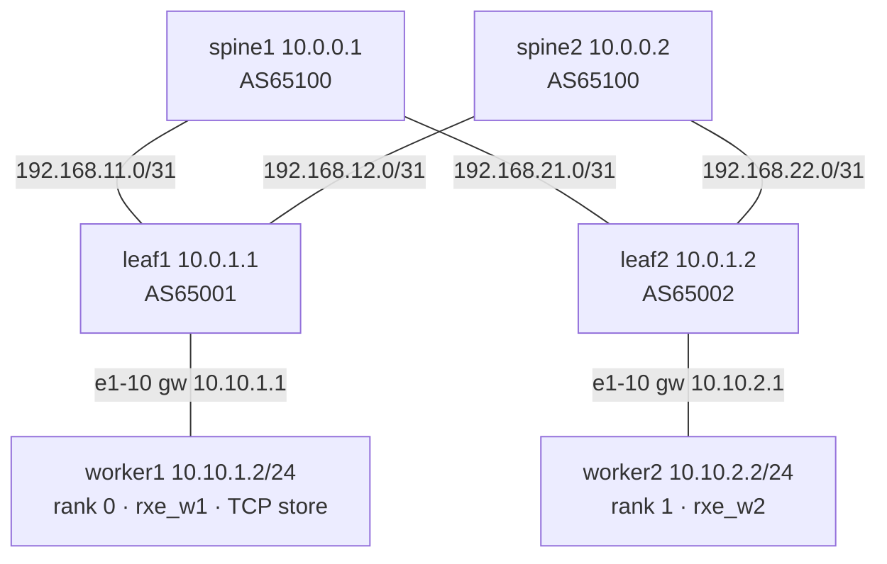
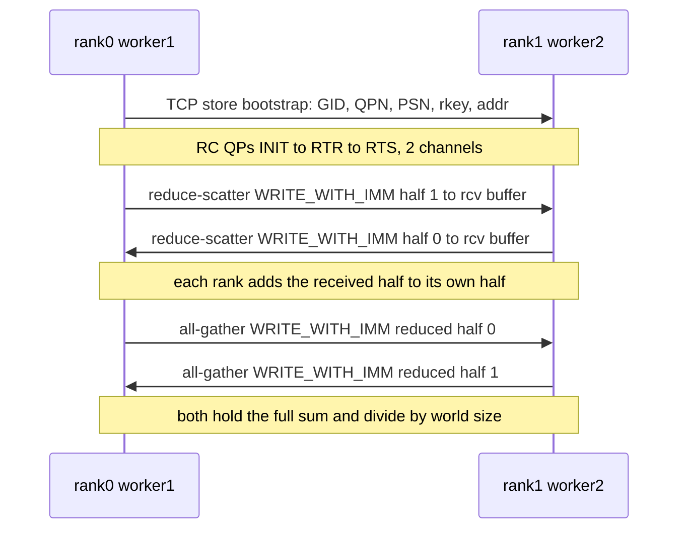

# Distributed AI Training over RoCEv2 on an SR Linux Clos

Data-parallel training spends every step on the same network pattern. Each worker runs a
forward pass, computes the loss, and backpropagates to produce **local gradients that differ
per worker**, because each worker sees different data. A **collective AllReduce** then averages
those gradients so every worker applies the **same optimizer step**. In GPU clusters that
collective is NCCL over RoCEv2. The fabric sees long-lived RDMA flows that are large, few in
number (low entropy) and loss-sensitive.

This lab reproduces that pattern end to end with no GPUs and no RDMA NICs:

- Two PyTorch CPU workers train an MLP. Gradients are synchronized every step with an
  **NCCL-style ring AllReduce** (reduce-scatter, then all-gather) built on libibverbs.
- Every gradient byte crosses the fabric as **real RoCEv2**: UDP/4791, InfiniBand BTH/RETH,
  RC queue pairs and ACKs. It comes from Linux **Soft-RoCE (`rxe`)** on each worker's `eth1`.
  Only the bootstrap rendezvous uses TCP, as in NCCL.
- The fabric is a minimal **2-leaf / 2-spine SR Linux Clos** with an eBGP underlay and 2-way
  ECMP. A RoCE QoS profile is applied: DSCP 26 for data in an ECN-enabled queue, DSCP 48 for CNP
  in strict priority.

The lab then measures what an AI fabric engineer cares about: wire bytes compared with gradient
bytes, per-QP ECMP placement, loss and go-back-N retransmission, the effect of sender pacing, and
a spine-link failure in the middle of training.

**[Interactive walkthrough](https://shakeerahmedshaik.github.io/nokia-ai-training-roce-lab/)** of one
training step on the wire: each AllReduce phase on the Clos diagram, per-opcode frame anatomy and the
capture charts, using the data in [`outputs/`](outputs). The page is [`docs/index.html`](docs/index.html),
served by GitHub Pages from `main:/docs`. Locally, run `python3 -m http.server -d docs` and open
`http://localhost:8000`.

## Topology



| Item | Value |
|---|---|
| Switches | 4 x SR Linux `ghcr.io/nokia/srlinux:26.7.2`, type `ixr-h5-64o` (7220 IXR-H5-64O, Tomahawk 5) as the TH6 stand-in. See [Platform: TH6 vs TH5](#platform-th6-vs-th5) |
| Workers | 2 x `python:3.11-slim` (Debian 13). PyTorch 2.x CPU, rdma-core, perftest and pyverbs on the system `python3` (3.13) |
| Underlay | eBGP over /31 links. Spines AS65100, leaves AS65001/65002. Accept-all policy (closed lab fabric), `multipath ebgp maximum-paths 2` |
| MTU | Worker `eth1` 9000, SR Linux subinterface `ip-mtu 9000`, RoCE path MTU 4096 |
| QoS | Classifier `ROCE`: DSCP 26 to `fc3`/`unicast-3` (WRED with ECN, 5-20 %), DSCP 48 to `fc6`/`unicast-6` (strict priority) |
| Collective | Ring AllReduce for 2 ranks, 2 RC QPs (channels) per rank, `RDMA WRITE` with immediate, traffic class `0x6a` (DSCP 26, ECT(0)) |

## Deploying the lab

The lab runs with [containerlab](https://containerlab.dev). `topology.clab.yml` describes the
topology, and every switch boots with its startup config from [`configs/`](configs).

Soft-RoCE is a host kernel facility, so load it once on the containerlab host **before** deploying:

```bash
sudo modprobe rdma_rxe ib_uverbs sch_netem
```

```bash
# deploy the lab
containerlab deploy -t topology.clab.yml

# install worker packages, address eth1, create rxe devices, apply RoCE QoS, verify the fabric
bash setup.sh

# destroy the lab
containerlab destroy -t topology.clab.yml --cleanup
```

With the [VS Code containerlab extension](https://containerlab.dev/manual/vsc-extension/), open
the topology file and click **Deploy**. `topology.clab.yml.annotations.json` holds the Clos layout
for the graph view, with spines on top and workers at the bottom. The `graph-level` labels do the
same for `containerlab graph`. SR Linux needs about 1-2 minutes to boot. `setup.sh` downloads
about 300 MB of PyTorch per worker and is intended for a fresh deployment.

### clabernetes (Kubernetes)

The same lab is available for [clabernetes](https://containerlab.dev/manual/clabernetes/) (one
pod per node) in two formats:

| Manifest | Format |
|---|---|
| [`c9s/ai-training-c9s.yaml`](c9s/ai-training-c9s.yaml) | `clabernetes.containerlab.dev/v1alpha1`, generated with `clabverter` from this repository. Contains a Namespace, the startup configs and `app/` files as ConfigMaps, and the Topology resource |
| [`c9s/ai-training-c9s-v09.yaml`](c9s/ai-training-c9s-v09.yaml) | `c9s.run/v1alpha1` (clabernetes 0.9+). Startup configs are inlined, and `app/` comes from the `ai-training-app` ConfigMap mounted at `/lab/app/`, because c9s rejects host binds. SR Linux nodes have SSH status probes. The workers are excluded from probing (no SSH server) and are `privileged` for the uverbs `mknod` |

```bash
# clabverter format
helm upgrade --install --create-namespace --namespace c9s \
    clabernetes oci://ghcr.io/srl-labs/clabernetes/clabernetes
kubectl apply -f c9s/ai-training-c9s.yaml

# c9s 0.9 format
kubectl -n default apply -f c9s/ai-training-c9s-v09.yaml
kubectl -n default wait --for=condition=TopologyReady topology/ai-training --timeout=25m

# regenerate the clabverter manifest after changing the topology, configs or app/
docker run --rm --user $(id -u) -v $(pwd):/clabernetes/work \
    ghcr.io/srl-labs/clabernetes/clabverter --stdout --naming non-prefixed \
    --topologyFile topology.clab.yml --destinationNamespace ai-training |
    sed 's|\${SRL_IMAGE:=\([^}]*\)}|\1|' > c9s/ai-training-c9s.yaml
```

Kubernetes has two constraints the containerlab host does not:

- Soft-RoCE still lives in the host kernel, so run `sudo modprobe rdma_rxe ib_uverbs` on **every
  cluster node** that can schedule a worker pod.
- `setup.sh`, `run.sh` and `scripts/` drive the containers with `docker exec`. On a cluster, run
  their commands with `kubectl exec` into the worker and switch pods.

The `sed` step pins the image literally, so the manifest does not depend on `${SRL_IMAGE}`
expansion. The v09 manifest is not regenerated by clabverter. When a config or `app/` file
changes, update its inlined copy as well.

## Accessing the network elements

```bash
ssh admin@clab-ai-training-leaf1
ssh admin@clab-ai-training-spine1
docker exec -it clab-ai-training-worker1 bash
```

| Script | Purpose |
|---|---|
| `run.sh <script.py> [args] [--wait]` | Starts rank 0 on worker1 and rank 1 on worker2, then prints both `/tmp/<script>.log` files |
| `scripts/capture.sh start\|stop <name> [--snap N]` | tcpdump on worker1 `eth1`, copied to `captures/<name>.pcap` |
| `scripts/analyze.sh <pcap>` | tshark worksheet: totals, conversations, frame sizes, BTH opcodes per QP, DSCP/ECN/TTL, RDMA WRITE detail, I/O graph |
| `scripts/fabric.sh [counters]` | BGP sessions, ECMP routes, spine interface counters |
| `scripts/rxe-stats.sh` | Soft-RoCE transport counters (retransmission indicators) and leaf ingress discards |
| `scripts/pace.sh <rate>\|off` | Token-bucket pacing on both workers (stands in for NIC rate control) |
| `scripts/netem.sh add <ms>\|del` | netem delay on worker2 `eth1` |
| `scripts/sweep.sh` | All one-variable-at-a-time sweeps, one summary row per run |
| `scripts/failover.sh` | Spine-link failure during a 40-step run |

## Configuration

### Fabric

Each leaf peers with both spines over /31 links and exports its worker subnet. Here is leaf1
(trimmed):

```
set / interface ethernet-1/10 subinterface 0 ip-mtu 9000
set / interface ethernet-1/10 subinterface 0 ipv4 address 10.10.1.1/24
set / interface ethernet-1/1 subinterface 0 ipv4 address 192.168.11.0/31
set / interface ethernet-1/2 subinterface 0 ipv4 address 192.168.12.0/31
set / network-instance default protocols bgp autonomous-system 65001
set / network-instance default protocols bgp afi-safi ipv4-unicast multipath ebgp maximum-paths 2
set / network-instance default protocols bgp neighbor 192.168.11.1 peer-as 65100
set / network-instance default protocols bgp neighbor 192.168.12.1 peer-as 65100
```

### RoCE QoS

[`configs/qos-roce.cli`](configs/qos-roce.cli) is committed by `setup.sh` on all four switches,
with each fabric port's subinterface classifier and output queues bound to it:

```
A:leaf1# info qos classifiers dscp-policy ROCE
    dscp 26 {
        forwarding-class fc3
        drop-probability low
    }
    dscp 48 {
        forwarding-class fc6
        drop-probability low
    }
```

On IXR-H5, `queue-management-profile` on an output queue is rejected unless a
`buffer-allocation-profile` sets the queue's `maximum-burst-size`. `enable-ecn` and
`slope-enabled` are list keys of `wred-slope`, not leaves.

### Workers and the collective

`setup.sh` gives each worker an `rxe` device on `eth1`. Each device has a RoCE v2 GID at index 1,
for example `::ffff:10.10.1.2`. The workers are privileged, but `/dev/infiniband/uverbs*` appears
on the host only after the device is created, so `setup.sh` also runs `mknod` for those nodes
inside each container.

[`app/roce_ring.py`](app/roce_ring.py) implements the collective with pyverbs:



Each half is striped across the channels. Every channel is its own RC QP, so it gets its own UDP
source port and can hash onto a different spine, which is what NCCL's multiple channels give a
real fabric. `--transport gloo` on both apps switches back to PyTorch DDP over Gloo/TCP for
comparison.

## Verification

The outputs below are from a live run. Some wide tables have their columns trimmed; the unedited
versions are in [`outputs/`](outputs).

### Fabric: BGP and 2-way ECMP

```
A:leaf1# show network-instance default protocols bgp neighbor
| default | 192.168.11.1 | spines | S | 65100 | established | ipv4-unicast [6/4/6] |
| default | 192.168.12.1 | spines | S | 65100 | established | ipv4-unicast [6/4/8] |
2 configured neighbors, 2 configured sessions are established, 0 disabled peers

A:leaf1# show network-instance default ipv4 route
10.10.2.0/24         bgp          0        170     >        192.168.11.1(route:local)
                                                            192.168.12.1(route:local)
```

```
worker1# ping -c 3 10.10.2.2
64 bytes from 10.10.2.2: icmp_seq=1 ttl=61 time=17.2 ms
```

TTL 61 confirms three routed hops: leaf, spine and leaf.

### RoCEv2 path

```
worker1# rdma link show
link rxe_w1/1 state ACTIVE physical_state LINK_UP netdev eth1

worker1# ib_write_bw -d rxe_w1 -x 1 -s 1048576 -F --report_gbits 10.10.2.2
 local address: LID 0000 QPN 0x004a PSN 0xffe968 RKey 0x0050ce
 GID: 00:00:00:00:00:00:00:00:00:00:255:255:10:10:01:02
 remote address: LID 0000 QPN 0x0046 PSN 0x425a41 RKey 0x004c36
 GID: 00:00:00:00:00:00:00:00:00:00:255:255:10:10:02:02
 #bytes     #iterations    BW peak[Gb/sec]    BW average[Gb/sec]
 1048576    30           0.104152            0.055661
```

The same test in loopback, with no fabric in the path, reaches 0.77 Gb/s. The roughly 75 Mb/s
ceiling through the fabric is the SR Linux container's software datapath, not RoCE
([`outputs/rxe-perftest.txt`](outputs/rxe-perftest.txt)).

### Experiment A: scalar AllReduce

Rank 0 starts with `[2.0]` and rank 1 with `[4.0]`. The ring sums them to `[6.0]` and divides by
the world size:

```
bash scripts/capture.sh start allreduce
bash run.sh allreduce.py --wait
bash scripts/capture.sh stop allreduce

rank=0 world=2 transport=roce before=2.0
rank=0 roce dev=rxe_w1 gid_index=1 qpn=[20, 21] peer_qpn=[20, 21] channels=2 tclass=0x6a (DSCP 26, ECN 2)
rank=0 after=3.0
rank=1 world=2 transport=roce before=4.0
rank=1 after=3.0
```

On the wire there are 16 RoCEv2 frames and a 34-frame TCP bootstrap. Opcode 11 is
`RDMA WRITE Only with Immediate` and opcode 17 is the RC `Acknowledge`. One UDP source port is
used per QP:

```
### UDP conversations
10.10.1.2:49552  <-> 10.10.2.2:4791   4 frames
10.10.1.2:49593  <-> 10.10.2.2:4791   4 frames
### RDMA WRITE (time, src, udp.srcport, opcode, destqp, psn, reth.dmalen)
0.062730  10.10.1.2  49552  11  0x000014  1742886  4
0.062811  10.10.1.2  49593  11  0x000015  5060475  4
### IP DSCP / ECN / TTL
      8 26  2  64  10.10.1.2
      8 26  2  61  10.10.2.2
```

### Experiment B: data-parallel training

```bash
bash scripts/capture.sh start train
bash run.sh train.py --steps 20 --features 1024 --hidden 2048 --wait
bash scripts/capture.sh stop train
bash scripts/analyze.sh captures/train.pcap
```

The model is `Linear(1024, 2048) -> ReLU -> Linear(2048, 1)`, which has 2,101,249 parameters and
8,404,996 bytes of FP32 gradient. Both ranks seed the model identically and draw different data:

```
rank=0 initial model_checksum=14.7218001951 eval_loss=1.104860
rank=0 probe local_grad_checksum=-92.9500525515
rank=1 probe local_grad_checksum=-295.0573299934
rank=0 step=0 loss=0.508393 synced_grad_checksum=-194.0036913864 compute_ms=13.5 allreduce_ms=1337.7
rank=1 step=0 loss=0.750062 synced_grad_checksum=-194.0036913864 compute_ms=13.6 allreduce_ms=1314.0
...
rank=0 step=19 loss=1.273046 synced_grad_checksum=287.0553281007 allreduce_ms=1087.2
rank=1 step=19 loss=1.220537 synced_grad_checksum=287.0553281007 allreduce_ms=1080.6
rank=0 final model_checksum=14.4236342852 eval_loss=1.041862
rank=1 final model_checksum=14.4236342852 eval_loss=1.041862
```

- **The local gradients differ:** -92.95 on rank 0 and -295.06 on rank 1.
- **After the RoCEv2 AllReduce both hold -194.0037,** which is exactly their mean. The checksums
  match at every step.
- **The final models are identical,** and held-out loss falls on both ranks. Per-step loss is on
  a fresh random batch, so it is noisy.
- **Compute takes about 20 ms per step and the AllReduce about 1.1 s,** so the job is
  network-bound, exactly as it would be on a slow fabric.

### Packet worksheet

| Observation | Result (Experiment B, worker1 `eth1`) |
|---|---|
| Endpoints | `10.10.1.2 <-> 10.10.2.2`, routed across the fabric (incoming TTL 61) |
| Transport | 210,311 RoCEv2 frames (841 MB) on UDP/4791, and 35 TCP frames (2.9 KB) for the bootstrap store only |
| QPs and channels | 4 UDP conversations: 2 channels in each direction, with source ports 50376 and 50447 |
| BTH opcodes | 6 `WRITE First` (RETH `dmalen 2101252`, one stripe), 7 `WRITE Middle`, 9 `WRITE Last with Immediate`, 17 `Acknowledge` |
| Frame size | 96 % of frames are 4154 B (4096 payload + 14 Eth + 20 IP + 8 UDP + 12 BTH + 4 ICRC). `WRITE First` adds a 16 B RETH, for 4170 B |
| Marking | All RoCE data frames carry DSCP 26 and ECN `10` (ECT(0)). No CE marks are seen, because the software datapath does not model queue-depth ECN |
| Data volume | The ideal is 8.4 MB x 20 steps = 168 MB sent per rank. Measured: worker1 sent 513 MB (3.05x) and worker2 325 MB (1.94x). The excess is go-back-N retransmission, explained below |
| Timing | The I/O graph in 0.5 s buckets shows about 20 MB bursts that track the roughly 1.1 s `elapsed_ms` per step |
| Model agreement | `final model_checksum=14.4236342852` on both ranks |

### ECMP placement and loss

Spine interface counter deltas over Experiment B
([`outputs/expB-ecmp.txt`](outputs/expB-ecmp.txt)):

```
spine   port          towards  in_MB(from leaf)  out_MB(to leaf)
spine1  ethernet-1/1  leaf1               168.4            168.1
spine1  ethernet-1/2  leaf2               168.1            168.4
spine2  ethernet-1/1  leaf1               173.0            167.2
spine2  ethernet-1/2  leaf2               167.2            173.0
```

The two channels of each direction hash onto different spines. With only two flows per direction,
that split is luck of the hash. In a real fabric this low entropy is why NCCL uses many channels,
and why adaptive routing and packet spraying exist.

The counters also show where the excess bytes go. worker1 transmitted 513 MB, but only 341 MB
reached the spines from leaf1. The difference matches the leaf ingress discards:

```
leaf1 ethernet-1/10 in-discarded-packets   65596 -> 103998
leaf2 ethernet-1/10 in-discarded-packets   27922 ->  64192
worker1 rxe_w1 duplicate_request 7286 -> 9619   out_of_seq_request 625 -> 1396   rcvd_seq_err 773 -> 1516
```

`rxe` sends each 4 MB write as fast as the veth allows, which is faster than the SR Linux
software datapath accepts. Frames are dropped at leaf ingress, the receiving QP sees a PSN gap and
NAKs, and RC retransmits **everything from the gap onward** (go-back-N). This is lossy RoCE
without PFC: a small loss rate multiplies the wire bytes.

## Change one variable at a time

`scripts/sweep.sh` runs every row below. Each row is 20 steps unless noted, with a header capture
on worker1 ([`outputs/sweeps.txt`](outputs/sweeps.txt)). `wire_MB` is both directions on worker1
`eth1`.

| Run | Params | Grad MB | Wire MB | Compute ms | AllReduce ms | Leaf discards | Checksums |
|---|---|---|---|---|---|---|---|
| hidden=256 | 262,657 | 1.1 | 88.3 | 7.1 | 539 | 8,856 | match |
| hidden=2048 | 2,101,249 | 8.4 | 866.0 | 18.0 | 1,459 | 93,078 | match |
| hidden=4096 | 4,202,497 | 16.8 | 1,755.0 | 43.0 | 2,335 | 173,313 | match |
| steps=1 | 2,101,249 | 8.4 | 50.6 | 23.3 | 2,394 | 7,360 | match |
| steps=20 | 2,101,249 | 8.4 | 991.6 | 22.5 | 1,769 | 117,598 | match |
| batch=8 | 2,101,249 | 8.4 | 970.3 | 15.0 | 1,713 | 113,709 | match |
| batch=64 | 2,101,249 | 8.4 | 971.1 | 35.5 | 1,698 | 105,804 | match |
| pace=off | 2,101,249 | 8.4 | 968.4 | 26.4 | 1,656 | 106,565 | match |
| **pace=100mbit** | 2,101,249 | 8.4 | **362.6** | 22.7 | **805** | **7** | match |
| pace=60mbit | 2,101,249 | 8.4 | 390.4 | 25.5 | 1,386 | 15 | match |
| delay=0ms | 2,101,249 | 8.4 | 943.5 | 23.1 | 1,624 | 108,711 | match |
| delay=5ms | 2,101,249 | 8.4 | 980.8 | 25.1 | 1,772 | 101,033 | match |
| delay=20ms | 2,101,249 | 8.4 | 869.4 | 23.4 | 1,915 | 83,371 | match |

- **Model size** scales gradient bytes, and wire bytes with them, linearly. Compute grows too, but
  stays 50 times smaller than the AllReduce.
- **Steps:** there is almost no startup traffic. The TCP bootstrap is about 3 KB, and QP setup is
  out-of-band. A single step costs about the same as any other step. Its higher AllReduce time is most
  likely first-step warm-up, since step 0 is also the slowest step in 20-step runs.
- **Batch size** changes compute (15 ms vs 35.5 ms) but not gradient bytes or AllReduce time.
- **Pacing** is the most important result. Capping each sender at 100 Mbit/s, just above the
  fabric's sustainable rate, removes almost all ingress drops. That cuts wire bytes by 63 % and
  **halves the AllReduce time**. This is what DCQCN rate control (or PFC) buys a real RoCE fabric.
  Pacing too far below the bottleneck, at 60 Mbit/s, costs time again.
- **Delay** adds to every reduce-scatter and all-gather round trip, so step time grows with RTT.
  With this much loss, retransmission noise dominates the trend.

## Failure scenario: spine link down during training

`scripts/failover.sh` paces both senders at 100 Mbit/s, starts a 40-step run, and sets leaf1
`ethernet-1/1` (to spine1) to `admin-state disable` at T+15 s. It enables it again at T+30 s
([`outputs/failover.txt`](outputs/failover.txt)):

```
12:27:15.853 leaf1 ethernet-1/1 admin-state disable
A:leaf1# show network-instance default ipv4 route
10.10.2.0/24         bgp          0        170     >        192.168.12.1(route:local)
12:27:38.037 leaf1 ethernet-1/1 admin-state enable

step=12  allreduce_ms=816.6
step=13  allreduce_ms=2965.3     <- in-flight frames on the spine1 QP lost, RC timeout + go-back-N
step=14  allreduce_ms=852.1
...
      2 final model_checksum=15.2648585702
```

One step stalls for about 2.1 s while the RC QP whose flow was on spine1 times out (QP `timeout
14`, about 67 ms per retry) and retransmits on the rehashed path through spine2. Training then
continues at full speed, the collective never fails (`retry_exceeded_err 0`), and both ranks end
with the same model. When the link returns, BGP re-establishes and leaf1 is back to two next-hops.

## Platform: TH6 vs TH5

The SR Linux 26.7.2 image recognizes `type: ixr-h6` as the **7220 IXR-H6-64**, the Tomahawk 6
platform:

```
sr_device_mgr: HwCard  Slot 1 CardType 85 - 7220 IXR-H6-64 revision 0
sr_license_mgr: CheckLicenseExpiration  no default license file nor configured license instances, posting license expiry
sr_app_mgr: Stopping application ...
```

Without a license, it stops every application about 20 s after boot, and the container exits. The
IXR-H5 types run unlicensed, so this lab uses `ixr-h5-64o` (7220 IXR-H5-64O, Tomahawk 5). To run
on IXR-H6, put an SR Linux license file next to the topology and set the following on the four
switches:

```yaml
      type: ixr-h6
      license: license.key
```

Either way, containerlab runs SR Linux's control plane and a software forwarding model. It does
**not** model Tomahawk queues, MMU headroom, ECN thresholds, PFC state machines, packet trimming,
or 400G/800G timing (the ports report 800G but forward at about 75 Mb/s). Those need physical
hardware or a hardware-faithful simulator.

## What this does NOT test

- **NCCL or GPUs.** The collective is a faithful two-rank ring over real RDMA verbs, but it is not
  NCCL. There are no NVLink, GPUDirect or CUDA streams.
- **DCQCN.** `rxe` neither generates nor reacts to CNPs, and the software datapath never sets CE.
  The DSCP 48 class is configured but stays empty. `scripts/pace.sh` stands in for the reaction
  point.
- **PFC and lossless operation.** The fabric is lossy, so you see go-back-N rather than pause
  frames.
- **Line-rate behaviour.** Absolute times reflect software forwarding. Use the ratios, such as
  wire bytes over gradient bytes, AllReduce time over compute time, and paced versus unpaced.

## Notes and gotchas

- **Host modules.** `rdma_rxe` and `ib_uverbs` must be loaded on the host. `/dev/infiniband` is
  empty until the first `rxe` device exists, and privileged containers only get a snapshot of
  `/dev` at start. `setup.sh` creates the `uverbs` character devices inside the workers.
- **RDMA netns mode is `shared`.** Both workers see both `rxe_w1` and `rxe_w2`. Each rank opens
  its own device by name (`ROCE_DEV`, set by `run.sh`).
- **pyverbs version.** Debian 13's `python3-pyverbs` is built for the system Python 3.13, not the
  image's `/usr/local` Python 3.11. Torch is installed for `/usr/bin/python3`, and `run.sh` uses
  it.
- **Receive work requests.** A pyverbs `RecvWR` needs at least one SGE, even for
  `WRITE_WITH_IMM`. The ring posts receives against a 64-byte sink MR.
- **Interface MTU.** SR Linux routed subinterfaces default to a 1500 B IP MTU. Without
  `ip-mtu 9000` on every fabric subinterface, 4096 B RoCE frames are dropped silently. Flush the
  workers' route cache (`ip route flush cache`) after changing MTUs, to clear stale PMTU entries.
- **Checksum offload.** Worker `eth1` has `tx` checksum offload off, so frames leaving the veth
  carry valid L4 checksums for SR Linux. TSO, GSO and GRO are off, so captures show wire-sized
  frames.
- **No transit capture on SR Linux.** tcpdump on a spine's `e1-x` only sees a fraction of the
  slow-path packets, because the datapath forwards around the kernel tap. Use the interface
  counters (`scripts/fabric.sh counters`) for placement.
- **Route-table syntax.** In 26.7 the route table is `show network-instance default ipv4 route`.
  `route-table ipv4-unicast prefix` is rejected.
- **Learning rate.** `train.py` defaults to SGD with `lr=0.003`. At `lr=0.01` this unnormalized
  MLP diverges within 20 steps: the loss grows and the gradient checksum flips sign each step.

## Raw outputs

Full, unedited command outputs from a run of this lab are in [`outputs/`](outputs). Captures go
to `captures/`, which is git-ignored because the Experiment B capture alone is about 840 MB.

## References

- [PyTorch distributed](https://docs.pytorch.org/docs/stable/distributed.html) · [DistributedDataParallel](https://docs.pytorch.org/docs/stable/generated/torch.nn.parallel.DistributedDataParallel.html)
- [NVIDIA NCCL collectives](https://docs.nvidia.com/deeplearning/nccl/user-guide/docs/usage/collectives.html)
- [linux-rdma/rdma-core](https://github.com/linux-rdma/rdma-core) (rxe, pyverbs) · [perftest](https://github.com/linux-rdma/perftest)
- [InfiniBand Architecture Specification, Annex A17: RoCEv2](https://www.infinibandta.org/)
- [containerlab](https://containerlab.dev) · [SR Linux](https://learn.srlinux.dev)
- Lab layout follows [nokia-evpn-anycast-mh-lab](../nokia-evpn-anycast-mh-lab)
